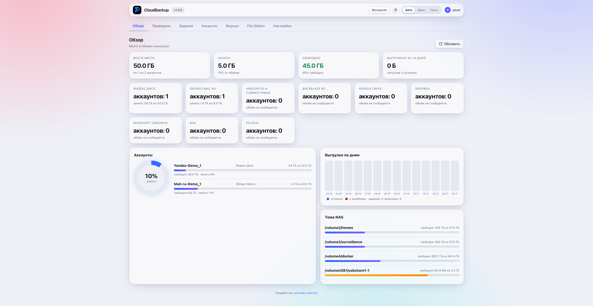
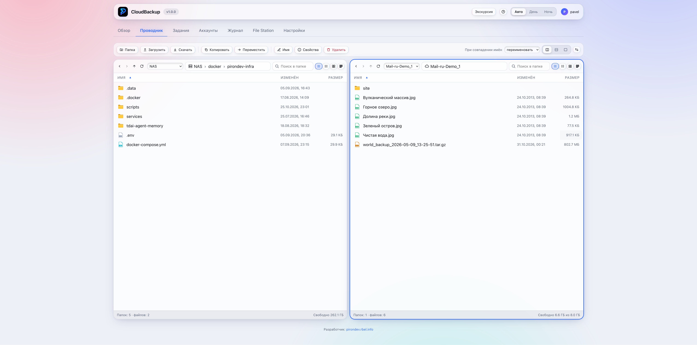

# CloudBackup для Synology DSM

CloudBackup создаёт резервные копии данных NAS в облачных хранилищах. Вы можете запускать задание вручную или по расписанию.

Приложение поддерживает зеркало, архивы с историей версий и несколько облачных аккаунтов. Файловый менеджер работает с NAS и подключёнными облаками.

*Главный экран показывает свободное место и состояние заданий.*

*Две панели позволяют просматривать NAS и облачное хранилище.*

## Поддерживаемые хранилища

- Яндекс.Диск.
- Облако Mail.ru.
- Amazon S3 и совместимые сервисы.
- Backblaze B2.
- Google Drive.
- Dropbox.
- Microsoft OneDrive.
- Box.
- pCloud.

## Возможности

- Копирование новых и изменённых файлов в режиме «Зеркало».
- Создание сжатых архивов с разбиением на части.
- Расписание заданий и журнал выполнения.
- Проверка загруженных данных.
- Шифрование архива до отправки в облако.
- WebDAV-доступ к аккаунтам из Synology File Station.

## Установка

Скачайте последний `.spk` из [последнего релиза](https://github.com/PironDev/SynologyCloudBackup/releases/latest). Затем установите пакет через Центр пакетов DSM.

Перед настройкой ознакомьтесь с [инструкцией по установке](docs/INSTALLATION.md). Для резервного копирования личных папок настройте разрешения системному пользователю пакета.

## Документация

- [Установка и первоначальная настройка](docs/INSTALLATION.md).
- [Руководство пользователя](docs/USER_GUIDE.md).
- [Разработка, сборка и выпуск](docs/DEVELOPMENT.md).
- [Участие в проекте](CONTRIBUTING.md).
- [Правила поведения](CODE_OF_CONDUCT.md).
- [Сообщение об уязвимости](SECURITY.md).
- [Права и лицензия](RIGHTS.md).

Файлы лицензии и её границы описаны в [LICENSE](LICENSE). Исходный код приложения хранится отдельно в приватном сабмодуле `app/`.
